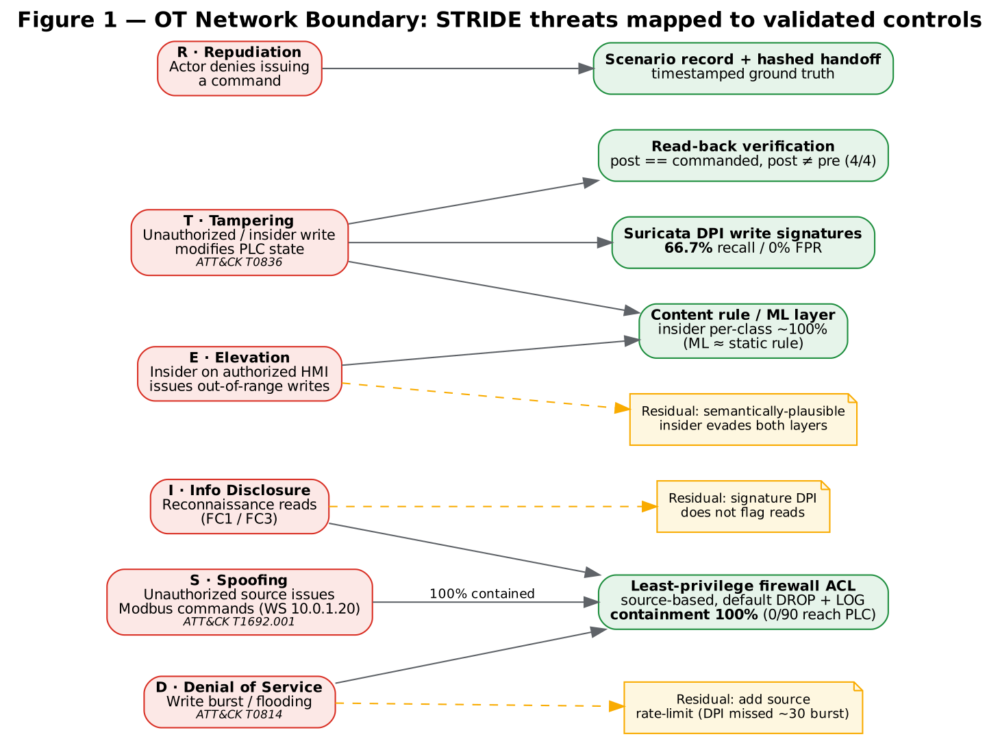
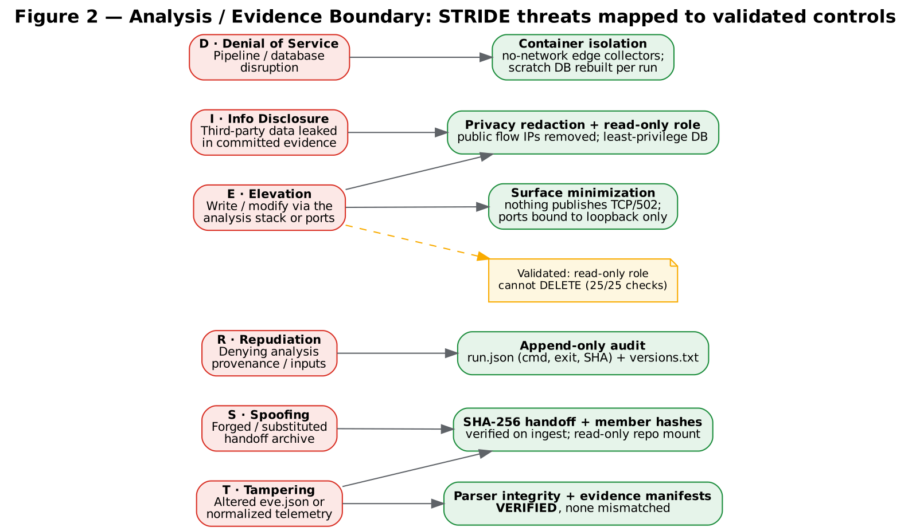

# Security Policy

## CYB691 / IT691 Capstone Team 4 — Cyber-Physical & Network Defense Monitoring

### Supported Versions
This project is developed as part of the CYB691/IT691 Cybersecurity Capstone (Fall 2026).

| Version | Supported          |
| ------- | ------------------ |
| 1.0.x   | :white_check_mark: |

---

## 🔒 Reporting a Vulnerability

As this repository contains research code, virtualized OT infrastructure scripts, and telemetry analysis pipelines for industrial control systems (ICS/OT):

1. **Do NOT open public GitHub issues** for security vulnerabilities, credential disclosures, or infrastructure exposure.
2. Direct all vulnerability reports to the project maintainers:
   - **Rachid Afaf** — Security Architect & Lead Security Analyst
   - **Erick Espinosa** — Infrastructure & OT Virtualization Lead
   - **Anil Kumar** — Security Hardening, Review & Documentation Lead
3. Maintainers will acknowledge reports within 48 hours and coordinate remediation within private branches prior to release.

---

## 🛡️ Threat Modeling & STRIDE Architecture (OWASP Threat Dragon v2.3.0)

This repository incorporates a repository-level STRIDE threat model formatted in **OWASP Threat Dragon v2.3.0 JSON** (`Team 4 Threat Model.json`).

### 1. Model Overview & Status at Milestone
* **File:** `Team 4 Threat Model.json` (Threat Dragon v2.3.0 Standard)
* **Total Tracked Threats:** 37 STRIDE threats across 32 components and 5 trust boundaries (status as recorded in the model: 37 Open).
* **Status at Report 2:** Report 2 experimental benchmarking is **complete** — the STRIDE controls have been empirically exercised against four recorded telemetry handoffs, and the validator's PROPERTY checks pass on each during ingest (**25/25** checks, 4/4 handoffs receipted). The threat-model JSON still records all 37 entries as **Open**: the audit reports status as recorded in the model and does not itself close threats, so the threat/mitigation rows remain to be reconciled against `Team 4 Threat Model.json`.
* **Automated Audit Script:** `validate_stride_threats.py` reports **INVENTORY** results (artifacts exist and are well formed) separately from **PROPERTY** results (a control was actually exercised: parser functions driven with hostile inputs, normalized data reconciled with raw `eve.json`, ML evaluation method checked). Inventory results are not evidence that a threat is mitigated.

### 2. Trust Boundaries
* **OT Network Boundary (`curve-ot-boundary`):** Segregates the Level 1–3 Purdue-model testbed from developer workstations and external networks. *(Report 2 testbed: real pymodbus 3.8.6 PLC `10.0.3.10:502` on `snet-ot`, reachable only through `vm-fwsensor` running iptables 1.8.10 (nf_tables) + Suricata 7.0.3 — every IT↔OT packet is inspected or dropped at the boundary; see `infrastructure/README.md` §1. The earlier 2026-09-26 Conpot capture on a flat Docker bridge has been superseded.)*
* **Analysis Evidence Boundary (`curve-analysis-boundary`):** Protects cross-zone telemetry handoff archives (`.tar.gz`), log parsing routines (`src/log_parser.py`), incident triage engines (`src/timeline_generator.py`), machine learning analytics (`src/ml_detector.py`), and post-mortem report deliverables.

**STRIDE boundary figures** (each mapping STRIDE threats to the validated controls; Graphviz `.dot` source + PNG + SVG in `img/`):





*Figure sources: [`img/fig1_ot_boundary.dot`](img/fig1_ot_boundary.dot), [`img/fig2_evidence_boundary.dot`](img/fig2_evidence_boundary.dot) — regenerate with `dot -Tpng -Gdpi=150 img/fig1_ot_boundary.dot -o img/fig1_ot_boundary.png` (and `-Tsvg`).*

### 3. STRIDE Threat Distribution (37 Open Threats)
* **Spoofing (2 Threats):** Impersonation of operators or developers during test script invocation (`flow-operator-commands`, `flow-source-code`). Mitigated via named accounts, MFA, RBAC, and commit signing.
* **Tampering (19 Threats):** Unauthenticated Modbus/TCP write commands (`FC05`, `FC06`, `FC16`), Suricata EVE JSON log tampering, dataset poisoning, and report alteration. Validated controls: iptables (nf_tables) boundary ACL on `vm-fwsensor` (**100%** containment — 0/90 unauthorized commands reach the PLC), Suricata write-function-code alerts (**66.7%** recall at 0% FPR), a content-aware anomaly layer for authorized-source insider writes (per-class ~100%; a static content rule matches the ML, so the rule is the operative control), and SHA-256 sidecar hashes on every handoff archive, verified on ingest.
* **Repudiation (2 Threats):** Unverified report provenance. Mitigated via source file SHA-256 hashes, git commit IDs, execution timestamps, and build manifests.
* **Information Disclosure (3 Threats):** EVE JSON log disclosure of OT layout, unencrypted transit, committed secrets. Mitigated via automated Gitleaks scanning, RFC 1918 private addressing, data redaction, and strict filesystem access control.
* **Denial of Service (5 Threats):** Testbed command floods, Suricata packet ring drops, ML feature matrix memory exhaustion. Mitigated via rate limiting, SPAN/TAP drop monitoring, bounded batch quotas, and process memory limits.
* **Elevation of Privilege (6 Threats):** Tar-Slip directory traversal in `log_parser.py`, malicious third-party Python package installation, and lateral movement from the analysis host. Validated controls: Tar-Slip / symlink-member rejection exercised by the P1 parser check, strict path-boundary verification (`is_within_directory`), pinned package dependencies, a least-privilege read-only PostgreSQL role, no TCP/502 published off the OT subnet, and the repository mounted read-only into the analysis container.

---

## 🔍 Automated STRIDE Validation Output (`validate_stride_threats.py`)

Current run on the Step 7 content-distinguishable handoff (`ot_telemetry_handoff_2026-11-15`, 493 Modbus transactions); the validator also runs and passes on the three source-separable handoffs (2026-11-04/07/14) during ingest. The full table is in `data/stride_validation_report.md`.

```text
INVENTORY | Threat model structure: 37 threats on 32 components, 5 trust boundaries; status as recorded in the model: {'Open': 37}
INVENTORY | Trust boundary 'OT Network Boundary': present in model
INVENTORY | Trust boundary 'Analysis Evidence Boundary': present in model
INVENTORY | Policy & licence files: present: SECURITY.md, requirements.txt, THIRD_PARTY_LICENSES.md, LICENSE (existence only - not a security test)
[PASS] PROPERTY | P1 Parser controls: exercised: Tar-Slip and link members refused, '-- No entries --' -> 0 drops,
                  real drop -> 1, non-Modbus EVE ignored, function_raw 6 preserved
[PASS] PROPERTY | P2 Normalized vs raw: 493 normalized Modbus events == 493 unique raw transactions;
                  function codes {1: 43, 3: 43, 5: 190, 6: 113, 15: 40, 16: 64} match; 92 firewall drops == raw drop lines
[WARN] PROPERTY | P3 ML evaluation: method checks passed; scenario record not yet confirmed by the team
                  (generator CSV as delivered); Random Forest recall 70.33% / FPR 26.35% vs targets >=95% / <=2%;
                  without function_code, Random Forest recall falls to 57.86% (detection rests on the function code;
                  the rule baseline gives the same result)
AUDIT PARTIAL: 2 property check(s) passed, 1 warning(s). Threat status is as recorded in the model ({'Open': 37});
              this audit does not close threats.
```

The negative control described in the Report 1 feedback (an empty parser, normalized data holding an empty object, an empty model-results object) now produces **FAIL** on P1, P2 and P3 (`tests/test_pipeline.py::test_validator_negative_control_reproduces_professor_probe`).

> **History.** The validator was first run on the 2026-09-26 Conpot capture (10 transactions). It now runs and passes on all **four** Report 2 handoffs during ingest — the three source-separable captures (2026-11-04/07/14) and the Step 7 content-distinguishable capture (2026-11-15) — via `up.ps1` (**25/25** checks, 4/4 receipted). The 2026-11-15 capture adds insider anomalies written from the authorized HMI (out-of-range address/value and burst timing), exercising the Tampering/Elevation paths source-based controls alone cannot see; the content layer detects them per-class ~100%, though a static content rule matches the ML (`docs/ablation-results.md`). The two STRIDE figures above map each threat set to these validated controls. Threat-model threat/mitigation rows remain to be confirmed against `Team 4 Threat Model.json`.

## 🔏 Captured Data Handling
Suricata's `eve.json` captures background host traffic on the Azure VM alongside the Modbus experiment. Third-party public IPs in non-Modbus `flow` records (inbound SSH/scanner traffic) have been **redacted before commit** and the `.sha256` sidecars regenerated; the Modbus, alert and firewall-drop evidence (all `10.0.x`) is unaffected. Do not make the repository public until the release decision in `THIRD_PARTY_LICENSES.md` §3 is recorded.

---

## 📜 Third-Party Reuse & Governance
Detailed terms, copyleft boundary separation, and pre-release license compliance verification procedures are documented in [THIRD_PARTY_LICENSES.md](THIRD_PARTY_LICENSES.md).
