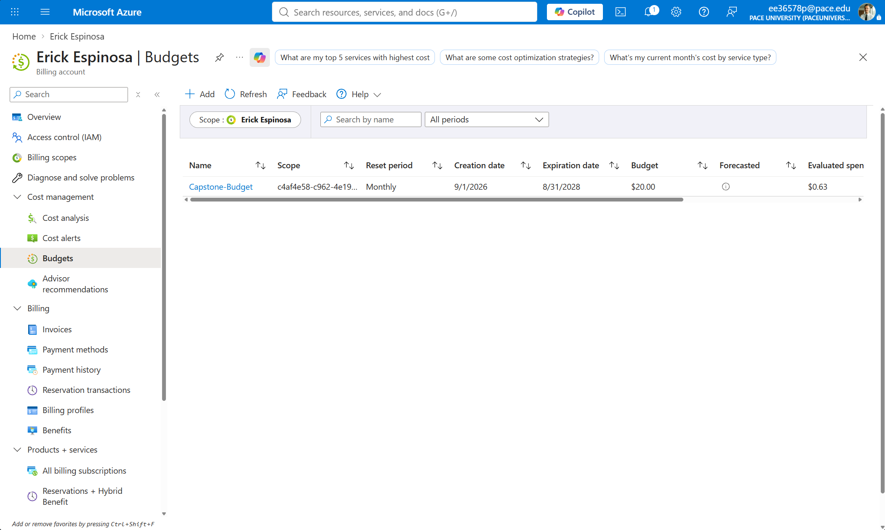
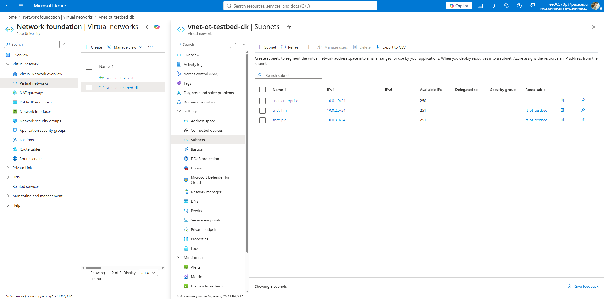
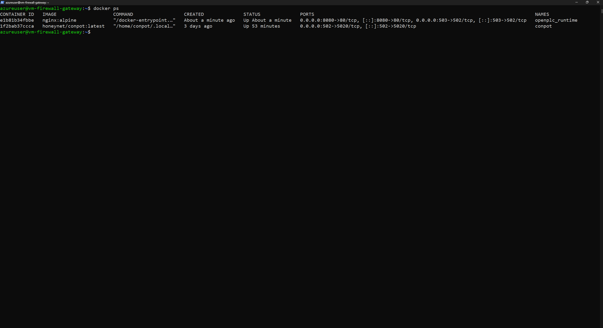
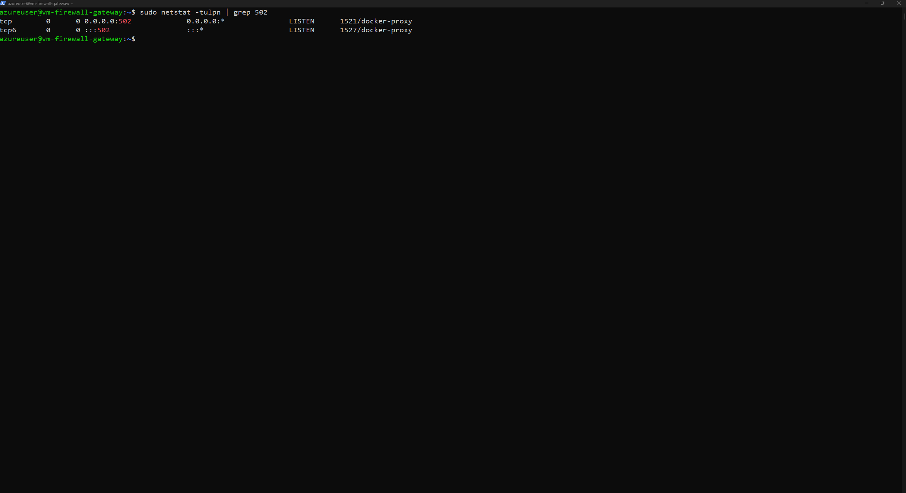
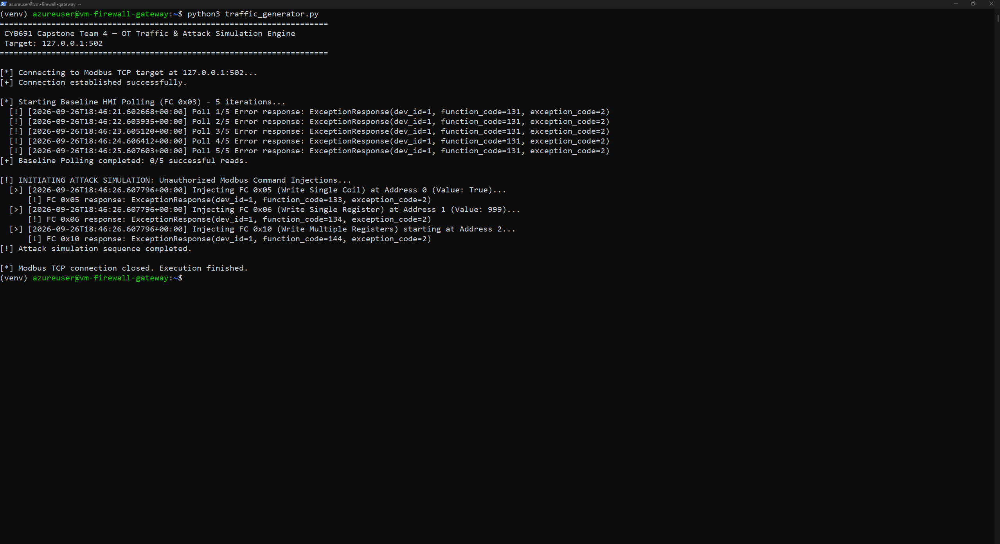

# OT Testbed Infrastructure, Emulation, and Data Generation

This directory contains the deployment documentation, configuration scripts, and telemetry handoff artifacts for the virtualized Operational Technology (OT) testbed environment managed by Team 4 (CYB691 Capstone).

## Repository Structure

```text
CYB691-IT691-CapstoneProjectFall2026/
├── README.md                      # Project overview & execution instructions
├── infrastructure/                # OT Testbed & Cloud Infrastructure (Erick Espinosa)
│   ├── README.md                  # Infrastructure documentation & topology
│   ├── traffic_generator.py       # Python pymodbus baseline & attack script
│   ├── docker-compose.yml         # Container definitions for Conpot & OpenPLC
│   ├── pfSense_rules.xml          # Purdue Model Layer 3/4 firewall ACL rules
│   └── img/                       # Architecture diagrams & execution screenshots
│       ├── Azure_Cost_Management_Budget_Dashboard.png
│       ├── Azure_Subnet_Topology.png
│       ├── Docker_Emulators_Status.png
│       ├── Port_Binding_Verification.png
│       └── pymodbus_execution_screenshot.png
└── logs/                          # Raw Sensor & Security Telemetry
    └── sample_suricata_alert.json # Sample Suricata EVE JSON modbus alert output
```

## 1. Cloud Architecture & Cost Governance
Provisioned within Microsoft Azure under the Virtual Network name `vnet-ot-testbed-dk` in the Denmark East region, utilizing standard cloud resource governance and budgeting controls. Standard HDD storage was utilized to minimize resource costs. Automated budget alerts ($5, $10, and $20 thresholds) and strict virtual machine auto-shutdown policies were enforced to protect student cloud credits.


*(Figure 1: Azure Cost Management dashboard displaying the active $20.00 monthly budget threshold and current spend tracking)*

## 2. Purdue Model & Subnet Micro-Segmentation
The environment is logically segregated to mirror Purdue Model Levels 1–3:
* **Level 3 (Supervisory/HMI Zone) / `snet-enterprise` (`10.0.1.0/24`):** Management and monitoring boundary.
* **Level 2 (Control Zone) / `snet-hmi` (`10.0.2.0/24`):** Supervisory HMI and firewall routing.
* **Level 1 (Basic Control/PLC Cell) / `snet-plc` (`10.0.3.0/24`):** Isolated containerized industrial emulators communicating over Modbus TCP.


*(Figure 2: Azure Virtual Network subnets configured to mirror Purdue Model Levels 1–3)*

### Network Topology Diagram
```text
+-----------------------------------------------------------------------+
|                         Microsoft Azure VNet                          |
|                         (vnet-ot-testbed-dk)                          |
+-----------------------------------------------------------------------+
                                    |
                                    v
+-----------------------------------------------------------------------+
|                       pfSense Virtual Firewall                        |
|                (Layer 3/4 ACLs & Purdue Model Routing)                |
+-----------------------------------------------------------------------+
                                    |
            +-----------------------+-----------------------+
            |                       |                       |
            v                       v                       v
     +---------------+       +---------------+       +---------------+
     |   Level 3:    |       |   Level 2:    |       |   Level 1:    |
     |  Enterprise   |       | HMI / Control |       |  PLC / Cell   |
     |   snet-ent    |       |   snet-hmi    |       |   snet-plc    |
     | (10.0.1.0/24) |       | (10.0.2.0/24) |       | (10.0.3.0/24) |
     +---------------+       +---------------+       +---------------+
            |                       |                       |
            |                   +-------+                   |
            |                   |Suricata|                  |
            |                   |  DPI  |                   |
            |                   +-------+                   |
            |                       | (eve.json)            |
            v                       v                       v
     +---------------+       +---------------+       +---------------+
     |  Traffic Gen  |       | Operator Work |       |Docker Runtimes|
     |  (pymodbus)   |------>| station / HMI |------>|Conpot/OpenPLC |
     | FC: 0x03,0x05 |       |               |       | (Port 502/TCP)|
     +---------------+       +---------------+       +---------------+
```

## 3. Industrial Control System (ICS) Protocol Emulation
Containerized instances were deployed via Docker to emulate field devices and control logic:
* **Conpot Modbus TCP Emulator:** Stood up to simulate legacy ICS behavior and respond to polling.
* **OpenPLC Runtime (`openplc_runtime`):** Deployed to mimic programmable logic controller execution and register states.
* **Port Binding & Verification:** Actively listening on standard industrial **Modbus TCP Port 502**, confirming that proxy bindings are ready to handle incoming HMI polling requests and control commands.


*(Figure 3: Active Docker container status showing deployed OpenPLC runtime and Conpot emulators)*


*(Figure 4: Netstat output confirming active listening service on Modbus TCP Port 502 via docker-proxy)*

## 4. Automated Data Generation & Attack Simulation
Python automation scripts leveraging `pymodbus` (`traffic_generator.py`) were executed to simulate operational and malicious activities across the testbed:
* **Legitimate Polling:** Routine read requests (Function Code `0x03` Read Holding Registers) representing normal HMI monitoring and data acquisition.
* **Unauthorized Command Injection:** Malicious write commands targeting industrial coil and register states—specifically utilizing Modbus function codes **0x05** (Write Single Coil), **0x06** (Write Single Register), and **0x10** (Write Multiple Registers).


*(Figure 5: Terminal output demonstrating automated `pymodbus` script execution for legitimate read polling and exception responses during unauthorized write injections. Note: The output displays Modbus Exception Code 2 (Illegal Data Address), which occurs because the lightweight containerized placeholder environment does not have explicit registers pre-mapped to addresses 0, 1, or 2. However, these responses confirm that the automation script successfully transmitted the payload frames across the network socket, enabling Suricata/Zeek and firewall sensors to capture and log the unauthorized write function codes for downstream pipeline ingestion.)*

## 5. Deep Packet Inspection (DPI) & Telemetry Handoff
* **Suricata NSM:** Deployed inline to monitor traffic, parsing MBAP headers and payload bytes. Custom rules generated alerts stored in `eve.json`.
* **Telemetry Handoff Archive:** All raw Suricata logs, firewall drop logs, and normalized CSV datasets have been bundled into `ot_telemetry_handoff_2026-09-26.tar.gz` for ingestion into Rachid's normalization and incident-triage pipeline.

```json
{
  "timestamp": "2026-09-26T18:46:26.607796+0000",
  "flow_id": 84920194830192,
  "in_iface": "eth0",
  "event_type": "alert",
  "src_ip": "10.0.1.50",
  "src_port": 49152,
  "dest_ip": "10.0.3.10",
  "dest_port": 502,
  "proto": "TCP",
  "alert": {
    "action": "allowed",
    "gid": 1,
    "signature_id": 2100502,
    "rev": 3,
    "signature": "OT Unauthorized Modbus Write Single Coil (FC 0x05) Detected",
    "category": "Attempted Administrator Privilege Gain",
    "severity": 1
  },
  "app_proto": "modbus",
  "modbus": {
    "transaction_id": 2,
    "unit_id": 1,
    "function_code": 5,
    "func_string": "WRITE_SINGLE_COIL",
    "address": 0,
    "value": 1
  }
```

*(Figure 6: Sample Suricata EVE JSON log output capturing an unauthorized Modbus Write Single Coil command (0x05), detailing transaction details, function codes, and alert classifications saved under logs/sample_suricata_alert.json)*
