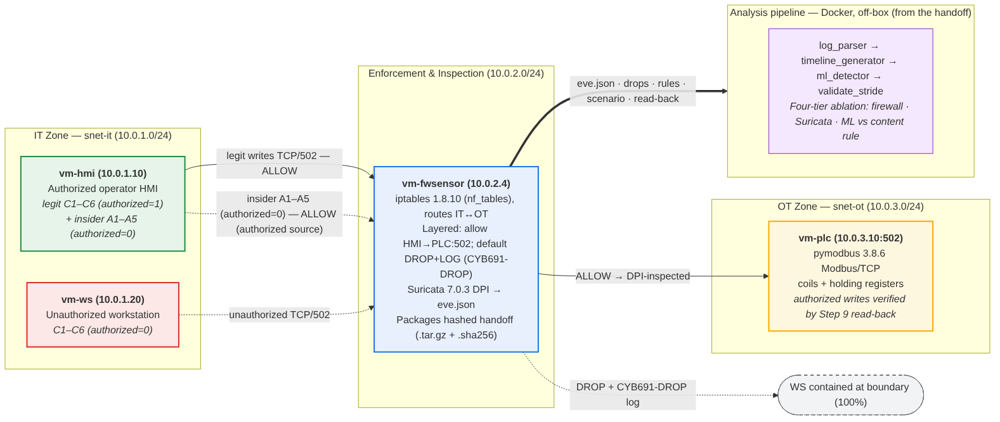

# OT Testbed Infrastructure, Emulation, and Data Generation

**CYB691 / IT691 Cybersecurity Capstone — Team 4**  
**Module lead:** Erick Espinosa (Infrastructure, Emulation & Data Generation)  
**Contributors:** Rachid Afaf (Security Architect & Detection Analytics), Anil Kumar (Documentation & Integration)

This directory holds the testbed scripts, the traffic generator, the cross-layer correlation tool, and the read-back verifier that together produce every telemetry handoff analysed by the pipeline. It documents the **Report 2 recorded testbed** — a purpose-built, fully-versioned Azure environment with a real Modbus PLC behind a firewall/IDS sensor.

> **Report 1 note.** The earlier **2026-09-26 Conpot** capture (flat Docker bridge, no firewall in path, writes rejected with Illegal Data Address) has been **superseded** by this testbed. That transition resolved Report 1 feedback #3 (environment specification), #13 (Conpot vs OpenPLC) and the "no write succeeded" finding (#2). The history is recorded in [`../docs/FEEDBACK_RESOLUTION.md`](../docs/FEEDBACK_RESOLUTION.md).

---

## 1. Testbed architecture

*Figure: current testbed network boundary and data flow. Source: [`../docs/architecture.mmd`](../docs/architecture.mmd).*

**Resource group:** Azure `rg-cyb691-lab-dk` (Denmark East). All VMs run on **UTC**. Deployed versions are recorded in `versions.txt` inside every handoff — verified: **Suricata 7.0.3 RELEASE**, **iptables v1.8.10 (nf_tables)**, **pymodbus 3.8.6**.

| Zone / level | Component | VM | Address / interface | Software | Status |
| :--- | :--- | :--- | :--- | :--- | :--- |
| Enterprise / L3 | HMI (authorized operator) | vm-hmi | `10.0.1.10` (snet-it, 10.0.1.0/24) | raw-socket Modbus generator | Evidenced |
| Enterprise / L3 | Workstation (unauthorized) | vm-ws | `10.0.1.20` (snet-it, 10.0.1.0/24) | raw-socket Modbus generator | Evidenced |
| Boundary / L2–3 | Firewall + IDS | vm-fwsensor | `10.0.2.4` (routes 10.0.1.0/24 ↔ 10.0.3.0/24) | **iptables 1.8.10 (nf_tables)** + **Suricata 7.0.3 RELEASE** | Evidenced |
| Field / L1 | PLC (Modbus server) | vm-plc | `10.0.3.10:502` (snet-ot, 10.0.3.0/24) | **pymodbus 3.8.6** — `run_server.py`, `di/co/hr/ir = ModbusSequentialDataBlock(0, [0]*999)`, `single=True` | Evidenced |

Every Modbus packet crosses `vm-fwsensor`, so the firewall and the IDS observe — or block — all IT↔OT traffic.

---

## 2. Firewall policies

Each capture is run twice on `vm-fwsensor`, so the ablation can isolate what segmentation adds:

* **Baseline (flat):** `FORWARD ACCEPT` — no segmentation; all traffic reaches the PLC.
* **Layered (segmented):** `FORWARD DROP` by default, an explicit allow for `HMI(10.0.1.10) → PLC(10.0.3.10):502`, `ESTABLISHED,RELATED` accepted, and a `CYB691-DROP` LOG rule before the final drop.

The deployed rule sets travel in each handoff (`iptables-baseline.rules`, `iptables-layered.rules`). The rsyslog filter is scoped to kernel `CYB691-DROP` lines, so `iptables_drops.log` holds only genuine kernel drops — e.g. **92 drops** in the 2026-11-15 capture (not empty).

---

## 3. Traffic generator (`traffic_generator.py`)

A standard-library, raw-socket Modbus/TCP generator (no pymodbus dependency, so it runs on any host). It **logs each action to the scenario CSV before sending it**, so firewall-blocked attempts are still recorded and ground-truth labels are written at execution time rather than reconstructed.

**Shared case set** (issued from both hosts with byte-identical payloads):

| Case | Function | Case | Function |
| :--- | :--- | :--- | :--- |
| C1 | FC1 ReadCoils | C4 | FC6 WriteSingleRegister |
| C2 | FC3 ReadHoldingRegisters | C5 | FC15 WriteMultipleCoils |
| C3 | FC5 WriteSingleCoil | C6 | FC16 WriteMultipleRegisters |

**Step 7 insider anomalies** (content-distinguishable; issued from the authorized HMI with `authorized=0`, so the source firewall passes them and only a content-aware layer can catch them): **A1** out-of-range address, **A2/A3** out-of-range register value, **A5** read-only-register write, **A4** write burst. Labels are **declared** via `--authorized`, never derived from the source IP (avoids label leakage).

---

## 4. Telemetry handoff contents

Each capture is packaged as a SHA-256-pinned `ot_telemetry_handoff_<date>.tar.gz` with a `.tar.gz.sha256` sidecar that is verified on ingest:

* **Ingested:** `eve.json` (Suricata Modbus DPI + alerts), `iptables_drops.log` (kernel `CYB691-DROP` lines), `scenario_file.csv` (ground truth).
* **Attachments (carried, not ingested):** `versions.txt`, `iptables-baseline.rules`, `iptables-layered.rules`, and the read-back evidence `pre.json` / `post.json` / `readback_verification.json`.

`scenario_file.csv` columns — source-separable captures: `timestamp_utc, run_id, topology, case_id, source_ip, dest_ip, function_code, authorized` (360 actions). The Step 7 capture adds `unit_id, address, quantity, value, inter_arrival_ms, anomaly_class` (14 columns, 664 actions).

> Derived analysis outputs (`correlated_results.csv`, `ablation_summary.json`) live in `data/runs/<handoff>/`, **not** inside the tarball, so re-ingestion stays idempotent. Content artifacts (`eve.json`, `scenario_file.csv`, `*.json`) are never hand-edited.

---

## 5. Captures and results

| Handoff | Type | Actions |
| :--- | :--- | :--- |
| `ot_telemetry_handoff_2026-11-04 / -07 / -14` | source-separable (HMI vs WS, identical payloads) | 360 each |
| `ot_telemetry_handoff_2026-11-15` | content-distinguishable (Step 7 insider anomalies A1–A5) | 664 |

All four ingest through the containerized pipeline: **25/25 checks, 4/4 handoffs receipted, 3,224 events, 32 incidents**. Per-capture totals — source-separable ≈ 270 MODBUS_DPI / 60 SURICATA_ALERT / 91–93 FIREWALL_DROP; Step 7 (2026-11-15) = 493 Modbus / 60 alerts / 92 drops / 485 scenario-labelled events.

**Headline findings** — firewall containment **100%** (0/90 unauthorized commands reach the PLC); Suricata **66.7%** recall at 0% FPR (writes only); the content layer catches the insider anomalies **per-class ~100%**, but a static content rule **matches the ML** (72.11% vs 71.81%), so ML adds no value over the rule; authorized writes confirmed by read-back (**4/4**, live on the PLC).

Full write-ups: [`../docs/ablation-results.md`](../docs/ablation-results.md) (four-tier ablation), [`../docs/readback-verification.md`](../docs/readback-verification.md) (read-back), [`../docs/Team4_Progress_Report_2.docx`](../docs/Team4_Progress_Report_2.docx) (Report 2), and `data/runs/<handoff>/correlated_results.csv` (cross-layer correlation). Deployment and pipeline: [`../docs/DEPLOYMENT_DOCKER.md`](../docs/DEPLOYMENT_DOCKER.md).

---

## 6. Privacy, ethics and licensing

* **Privacy.** Suricata `eve.json` captures background host traffic alongside the Modbus experiment. Third-party public IPs in non-Modbus `flow` records (inbound SSH/scanner traffic, Azure platform addresses) are **redacted before commit**; the Modbus, alert and firewall-drop evidence (all `10.0.x`) is unaffected.
* **Safety.** All Modbus traffic targets the lab PLC only. No production or third-party control system is contacted, and the analysis side never issues control commands.
* **Licensing.** Tool and data terms are in [`../THIRD_PARTY_LICENSES.md`](../THIRD_PARTY_LICENSES.md).
